<div align="center">

# ☁️ Azure Cloud Infrastructure & Security Lab

### Secure Windows infrastructure in Microsoft Azure

Hands-on cloud security project covering **virtual networking, NSGs, Windows Server, managed identity, RBAC, Azure Policy, Activity Logs, and Azure CLI**.


</div>

---

## 📌 Project Summary

This project demonstrates how I built and secured a small Microsoft Azure environment from the ground up.

I created the resource organization, virtual network, private Windows subnet, Network Security Group, and Windows Server 2025 virtual machine. I then added identity, least-privilege access, governance, monitoring, and command-line verification.

The final design emphasizes:

- **Least privilege**
- **Reduced public exposure**
- **Network segmentation**
- **Governance and compliance visibility**
- **Auditable administration**
- **Clear documentation and validation**

---

## 🧭 At a Glance

| Area | Implementation |
|---|---|
| Cloud platform | Microsoft Azure |
| Resource group | `rg-cloud-security-lab` |
| Virtual network | `vnet-cloud-security-lab` — `10.0.0.0/16` |
| Windows subnet | `snet-windows` — `10.0.1.0/24` |
| Network security | `nsg-windows-lab` |
| Compute | `vm-windows-lab` — Windows Server 2025 |
| Identity | System-assigned managed identity |
| Authorization | Reader RBAC role |
| Governance | Azure Policy — location audit |
| Monitoring | Azure Activity Log |
| CLI validation | Azure Cloud Shell / Azure CLI |
| Final exposure | No permanent public IP / no permanent public RDP |

---

## 🏗️ Architecture

<div align="center">

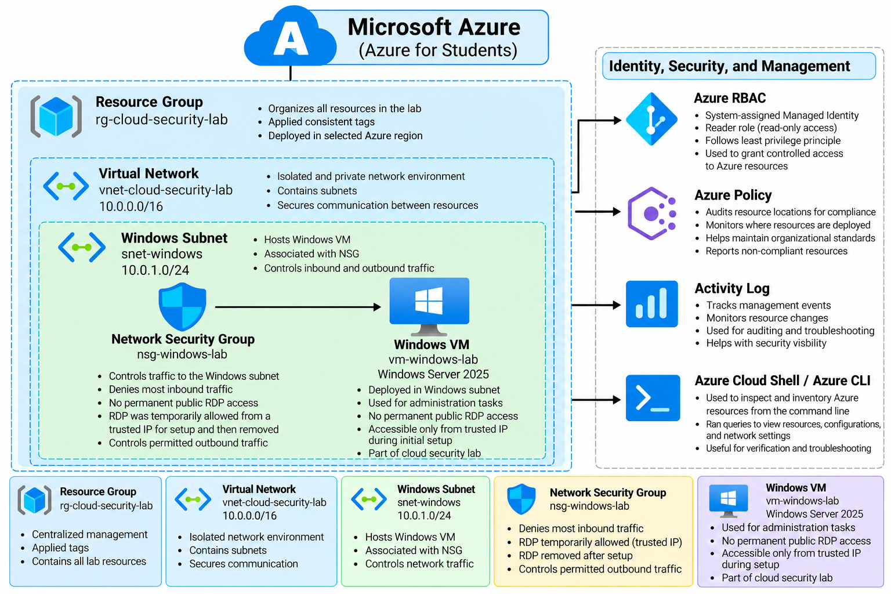

</div>

### Architecture Notes

The final Windows-focused environment places `vm-windows-lab` inside `snet-windows`, which is part of `vnet-cloud-security-lab`. `nsg-windows-lab` controls network traffic for the Windows subnet.

Identity, RBAC, Azure Policy, Activity Log monitoring, and Azure Cloud Shell / CLI provide the surrounding security, governance, and management layers.

---

# 🛠️ Project Walkthrough

## 1. Azure Student Environment

I used an **Azure for Students** subscription as the lab environment.

### What I did
- Activated the Azure student environment
- Used the subscription as the deployment boundary for the project
- Kept the lab isolated from production workloads

### Why it matters
A controlled subscription provides a safe place to practice cloud administration and security without affecting production resources.

---

## 2. Cost Protection

Before deploying resources, I configured cost protection and budget alerts.

### What I did
- Created a monthly budget
- Added alert thresholds
- Monitored resource usage to avoid unexpected charges

### Why it matters
Cloud security and cloud administration both require cost awareness. Misconfigured or forgotten resources can create unnecessary spend.

> A dedicated budget screenshot is not included because cost protection is a supporting control rather than one of the main technical artifacts of the project.

---

## 3. Resource Group & Tags

I created:

```text
rg-cloud-security-lab
```

in **West US 2** and applied project tags.

<div align="center">

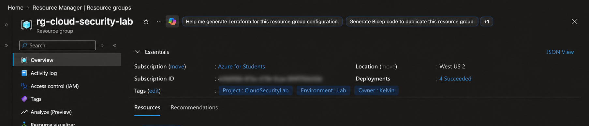

</div>

**Screenshot explanation:** This shows the resource group, region, and project tags used to organize the lab. Sensitive subscription identifiers were excluded from the public image.

### Why it matters
Resource groups provide a logical management boundary, while tags improve organization, ownership tracking, filtering, and governance.

---

## 4. Virtual Network

I created:

```text
vnet-cloud-security-lab
Address space: 10.0.0.0/16
```

<div align="center">

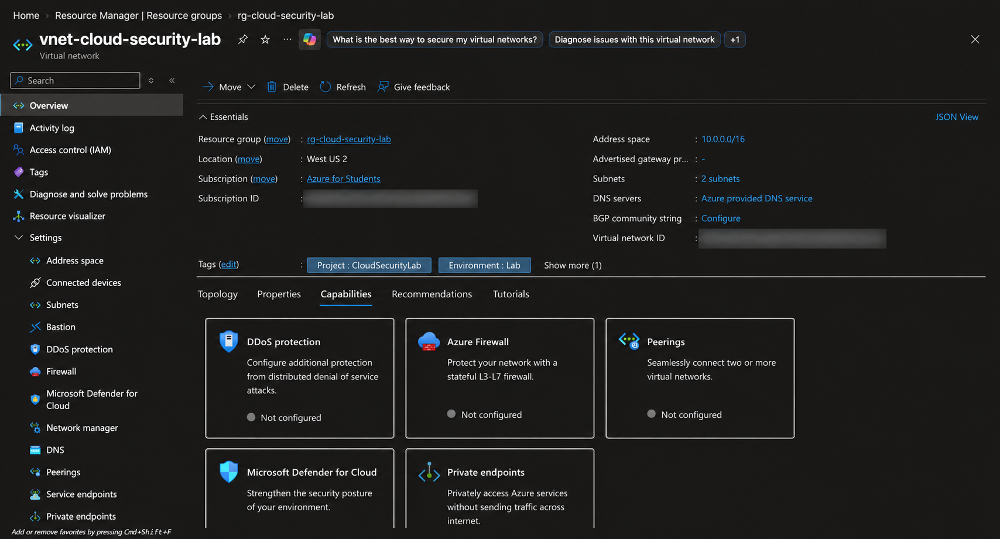

</div>

**Screenshot explanation:** This shows the VNet overview, `10.0.0.0/16` address space, West US 2 location, subnet count, and Azure-provided DNS.

### Why it matters
The VNet provides the private network boundary for Azure workloads and supplies the IP address space used by subnets.

---

## 5. Windows Subnet & Private Networking

I configured:

```text
snet-windows
10.0.1.0/24
```

<div align="center">

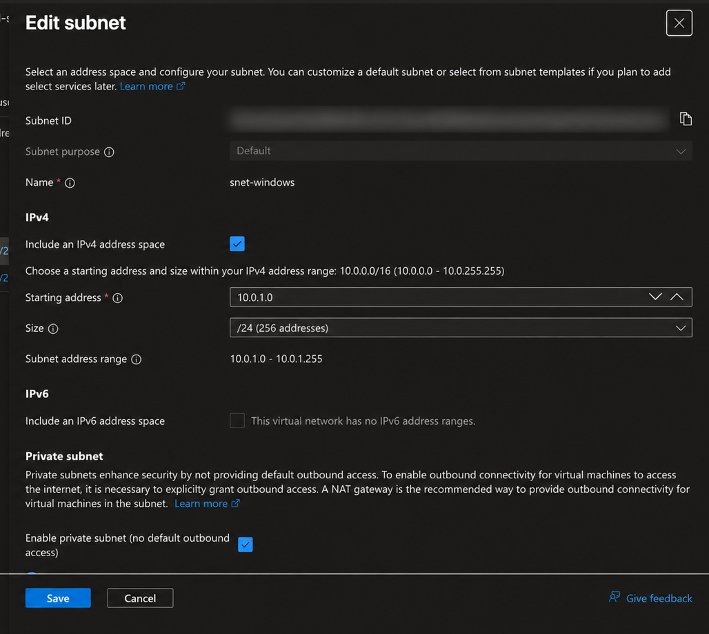

</div>

**Screenshot explanation:** This shows `snet-windows` using `10.0.1.0/24` and the private subnet configuration.

### Why it matters
Subnets divide a VNet into smaller security and management zones. This makes it easier to organize workloads and apply different network controls.

> A Linux subnet was staged earlier in the lab, but the Linux VM portion was intentionally skipped. The final architecture is Windows-focused.

---

## 6. Network Security Group & Temporary RDP

I created:

```text
nsg-windows-lab
```

During setup, I temporarily allowed RDP over **TCP/3389** for administration.

<div align="center">

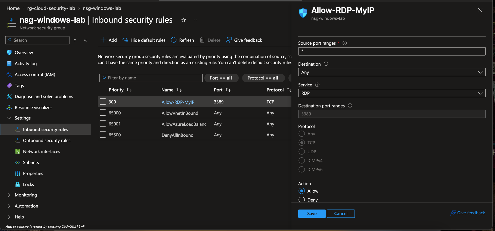

</div>

**Screenshot explanation:** This shows the temporary `Allow-RDP-MyIP` inbound rule for TCP port `3389`, plus Azure's default inbound rules including `DenyAllInBound`.

### Security decision
RDP was used only for setup/testing and was not left as permanent public exposure.

### Why it matters
NSGs act as Azure network traffic filters. Rule priority, protocol, source, destination, port, and action determine whether traffic is allowed or denied.

---

## 7. Windows Server 2025 VM Configuration

I configured:

```text
vm-windows-lab
Windows Server 2025 Datacenter: Azure Edition
Trusted Launch
x64
```

<div align="center">

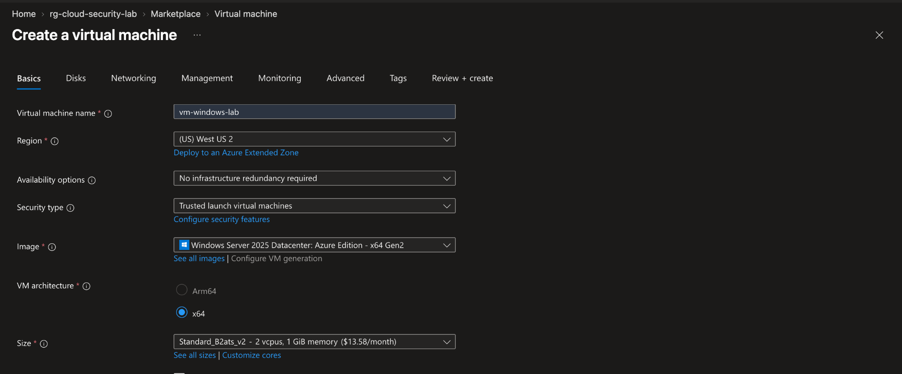

</div>

**Screenshot explanation:** This shows the VM name, region, Trusted Launch security type, Windows Server 2025 image, architecture, and compute size.

### Why it matters
VM deployment requires security and infrastructure decisions beyond simply choosing an operating system.

---

## 8. Successful VM Deployment

After reviewing the configuration, I deployed the Windows server.

<div align="center">

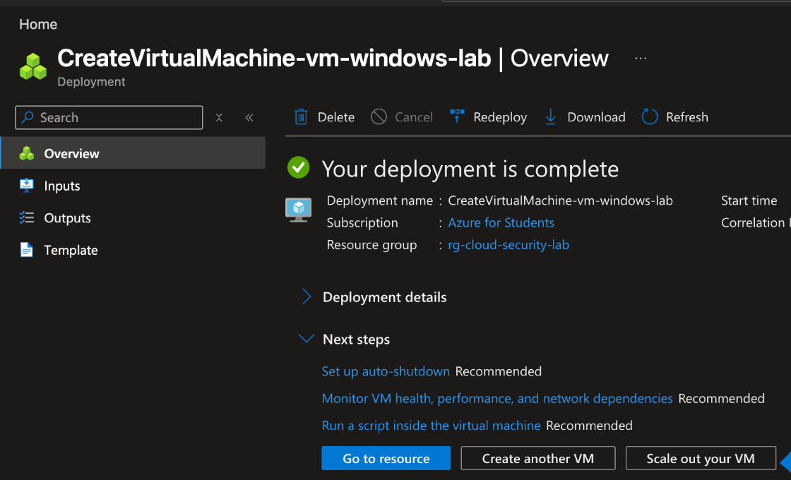

</div>

**Screenshot explanation:** Azure reports **“Your deployment is complete”** for the Windows VM deployment inside `rg-cloud-security-lab`.

### Why it matters
This provides clear deployment evidence that the compute workload was created successfully.

---

## 9. Secure VM Access & Reduced Public Exposure

After testing RDP access, I removed the public IP so the VM was no longer directly reachable from the public internet.

<div align="center">

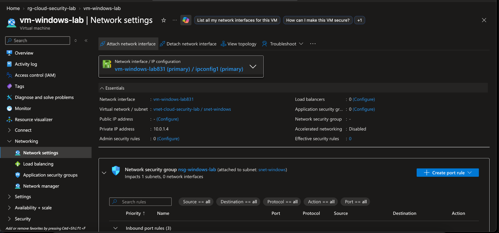

</div>

**Screenshot explanation:** This shows `vm-windows-lab` connected to `vnet-cloud-security-lab / snet-windows` with private IP `10.0.1.4`, no public IP, and the Windows NSG attached to the subnet.

### Security decision
The final state favors private networking instead of leaving permanent internet-facing administration enabled.

---

## 10. Managed Identity & Azure RBAC

I enabled a **system-assigned managed identity** for the VM and assigned it the **Reader** role.

<div align="center">

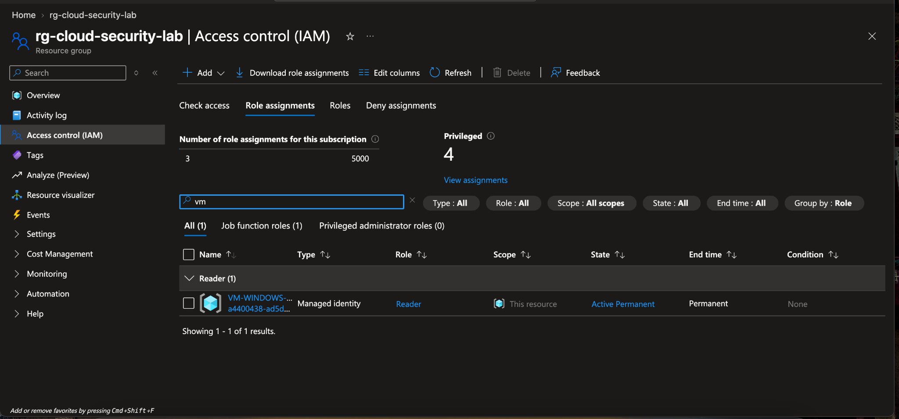

</div>

**Screenshot explanation:** This shows the VM managed identity in Azure IAM with the `Reader` role.

### Why it matters
The Reader role supports least privilege by allowing read-only access instead of unnecessary modification permissions.

### What I learned
Azure RBAC answers:

> **Who or what can perform which actions at what scope?**

Managed identities let Azure resources authenticate without storing credentials in code or configuration.

---

## 11. Azure Policy Governance

I assigned:

```text
audit-location-match
```

to audit resource-location compliance.

<div align="center">

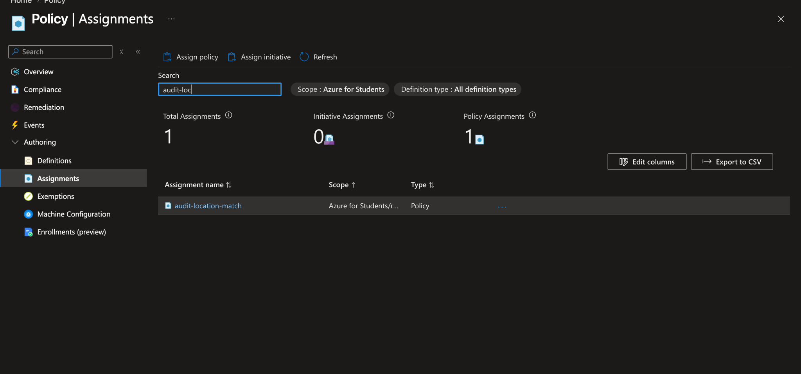

</div>

**Screenshot explanation:** This shows the `audit-location-match` policy assignment on the Azure Policy Assignments page.

### Why it matters
This policy provides governance visibility rather than blocking deployment.

### What I learned
- **RBAC** controls permissions
- **Azure Policy** evaluates compliance

They solve different security and governance problems.

---

## 12. Activity Log Monitoring

I reviewed the **Azure Activity Log** for administrative events and resource changes.

<div align="center">

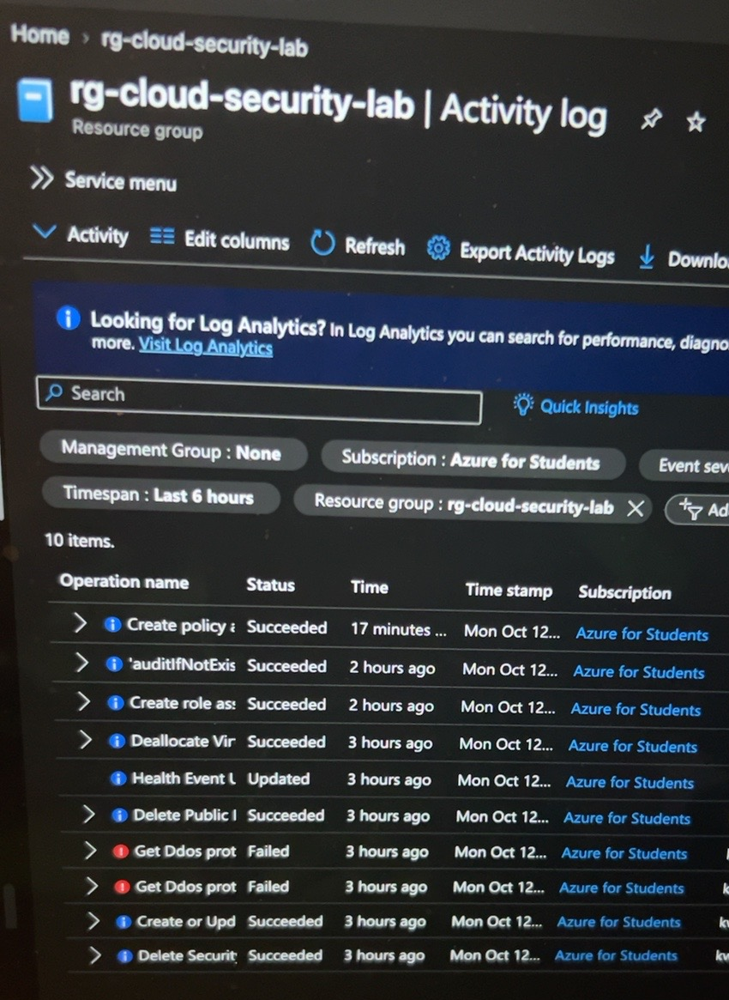

</div>

**Screenshot explanation:** This shows Activity Log entries for `rg-cloud-security-lab`, including operation names, status, timestamps, and subscription context.

### Privacy protection
The original screenshot showed the account email in the `Event initiated by` column. The public GitHub version was cropped so the email is not exposed.

### Why it matters
Activity Log provides a management-plane audit trail useful for troubleshooting, accountability, change tracking, and security investigations.

---

## 13. Azure Cloud Shell & Azure CLI

I used Azure Cloud Shell and Azure CLI to inspect the environment from the command line.

<div align="center">

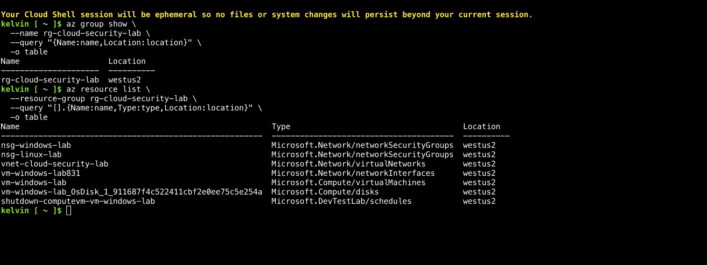

</div>

**Screenshot explanation:** This shows `az group show` and `az resource list` output confirming the resource group and inventorying the Azure resources and their locations.

### Why it matters
The Azure portal provides a graphical interface, while Azure CLI provides a repeatable command-line method for verification and administration.

📄 Exact commands: [`cli/azure-cli-commands.md`](cli/azure-cli-commands.md)

---

## 14. Architecture Documentation

After completing the environment, I created a final architecture diagram.

<div align="center">


</div>

**Diagram explanation:** This summarizes the relationship between the resource group, VNet, Windows subnet, NSG, Windows VM, RBAC, Azure Policy, Activity Log, and Azure Cloud Shell / CLI.

### Why it matters
A strong architecture diagram helps another engineer, recruiter, or hiring manager understand the environment quickly.

---

# 🔐 Security Decisions

| Decision | Security Benefit |
|---|---|
| Dedicated VNet + subnet | Segments the Windows workload |
| NSG on Windows subnet | Filters allowed network traffic |
| Temporary RDP only | Reduces long-term remote-access exposure |
| Removed public IP | Prevents permanent direct internet reachability |
| System-assigned managed identity | Avoids stored Azure credentials |
| Reader RBAC role | Implements least privilege |
| Azure Policy audit | Adds governance visibility |
| Activity Log review | Adds administrative auditability |
| CLI verification | Independently validates deployed resources |

---

# 🧪 Azure CLI Commands

### Verify the resource group

```bash
az group show \
  --name rg-cloud-security-lab \
  --query "{Name:name,Location:location}" \
  -o table
```

### Inventory the resources

```bash
az resource list \
  --resource-group rg-cloud-security-lab \
  --query "[].{Name:name,Type:type,Location:location}" \
  -o table
```

More details are available in [`cli/azure-cli-commands.md`](cli/azure-cli-commands.md).

---

# 🎯 Skills Demonstrated

| Cloud Infrastructure | Security & Governance | Administration |
|---|---|---|
| Azure Resource Groups | Network Security Groups | Windows Server 2025 |
| Virtual Networks | Managed Identity | Azure Portal |
| Subnetting | Azure RBAC | Azure Cloud Shell |
| Private networking | Least privilege | Azure CLI |
| IP addressing | Azure Policy | Resource inventory |
| VM deployment | Activity Log auditing | Technical documentation |

---

# 🧠 What I Learned

This project helped me understand how Azure infrastructure components work together instead of treating each service as an isolated configuration.

The biggest lesson was that a cloud environment is **not finished when a VM successfully starts**. The surrounding network exposure, identity, permissions, governance, monitoring, and documentation are equally important.

I gained hands-on experience with:

- Azure network design
- Subnetting and private addressing
- Network Security Groups
- Windows Server deployment
- Temporary RDP administration
- Managed identities
- RBAC and least privilege
- Azure Policy
- Activity Log monitoring
- Azure Cloud Shell
- Azure CLI
- Cloud architecture documentation

---

# 💼 Why This Is a Cloud Security Project

This project goes beyond launching a virtual machine.

The workload was:

**Segmented → Filtered → Securely administered → Removed from permanent public exposure → Given least-privilege permissions → Evaluated by policy → Monitored through logs → Verified through CLI**

These are practical concepts used in cloud support, cloud administration, security operations, and cloud security engineering.

---

# ⚙️ Technology Stack

`Microsoft Azure` · `Azure Virtual Network` · `Azure NSG` · `Azure VM` · `Windows Server 2025` · `Managed Identity` · `Azure RBAC` · `Azure Policy` · `Azure Activity Log` · `Azure Cloud Shell` · `Azure CLI`

---

# 📁 Repository Structure

```text
azure-cloud-infrastructure-security-lab/
├── README.md
├── architecture/
│   ├── README.md
│   └── azure-architecture.png
├── screenshots/
│   ├── README.md
│   ├── 01-resource-group-and-tags.png
│   ├── 02-vnet-overview.png
│   ├── 03-windows-subnet-private-networking.png
│   ├── 04-temporary-rdp-nsg-rule.png
│   ├── 05-windows-vm-configuration.png
│   ├── 06-windows-vm-deployment-success.png
│   ├── 07-windows-vm-private-networking.png
│   ├── 08-rbac-reader-role.png
│   ├── 09-azure-policy-audit-location.png
│   ├── 10-azure-activity-log.png
│   └── 11-azure-cloud-shell-cli-inventory.png
└── cli/
    └── azure-cli-commands.md
```

---

# 📎 Scope Notes

- Linux VM deployment was intentionally skipped
- Microsoft Sentinel was intentionally excluded
- Azure Firewall was not deployed
- Azure Bastion was not deployed
- Final Windows VM design does not rely on permanent public RDP access

---

<div align="center">

### ✅ Project Status: Complete

**Azure Cloud Infrastructure & Security Lab**

</div>
